<h1 align='center'>Hey, I'm Moge</h1>

I'm a Software Engineer who enjoys building scalable backend systems and APIs, particularly in high-volume e-commerce environments. I mainly work with Java, Python and TypeScript. Always curious about how things work, how they can work better, and what I can build next.

## 🔨 What I work on

- AI-powered applications and agentic workflows
- Event-driven systems and streaming backends
- E-commerce, order management and promotion systems
- APIs, GraphQL and distributed microservices
- Cloud-native applications on AWS and GCP

## 🎓 Education

- M.Sc. Computer Science, Humboldt University Berlin
- B.Sc. Computer Science and Business (Information Systems), University of Trier

## ✍🏿 Writing

Writing about software engineering, the thinking behind the code, and the systems that make it all work (or occasionally don't): 

## 🖥️ Tech Stack

### Languages

### Backend & APIs

